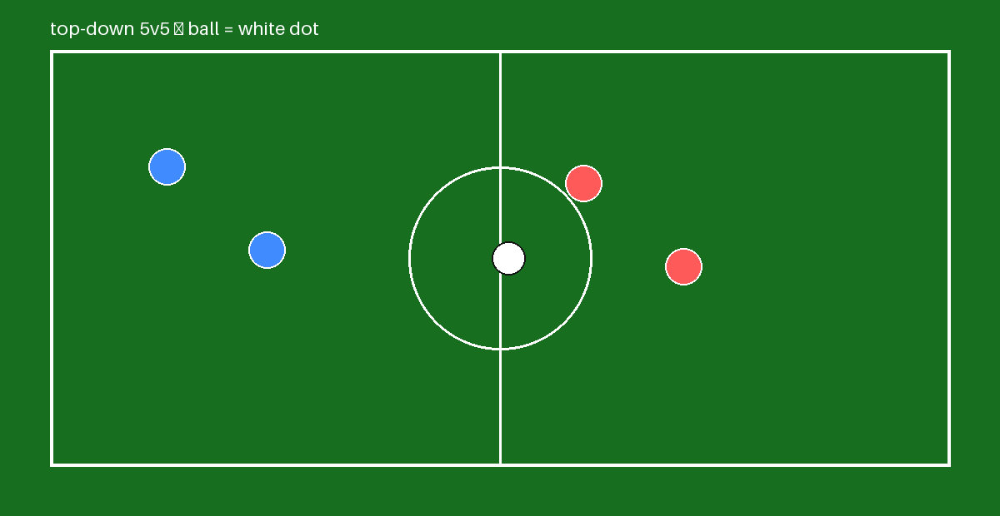
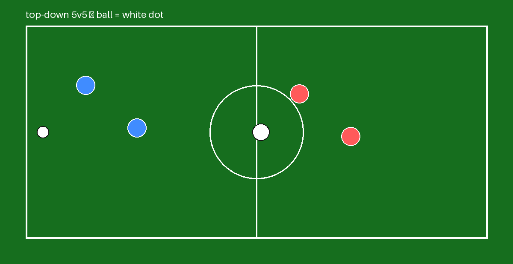
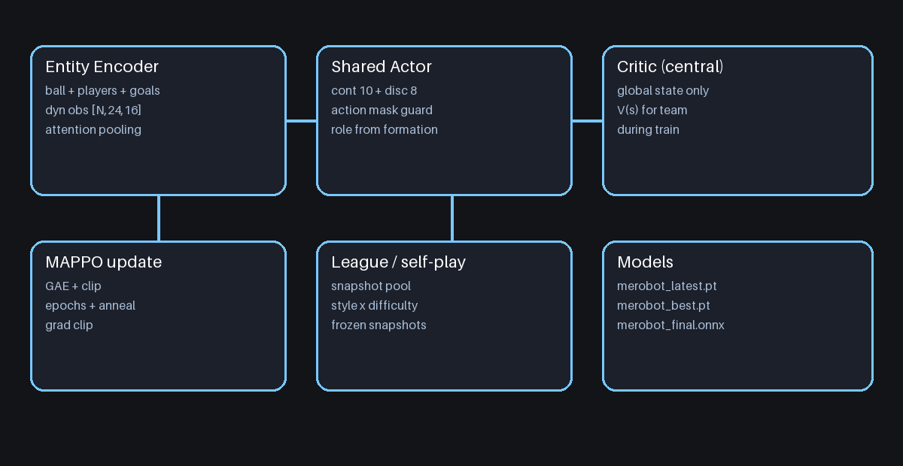

# STRYK

Football team training on FC27 physics, MAPPO + shared actor + centralized critic + self-play. Python/PyTorch.





Mode: 11v11 | 7v7 | 5v5 | 3v3 | 2v2 | 1v1
Stadiums: bernabeu_fc27, campnou_fc27, etihad_fc27, wembley_fc27, signal_fc27, allianz_fc27, sansiro_fc27, cruyff_fc27, meadow_fc27, dome_fc27, desert_fc27, alpine_fc27

How I run it:

```bash
git clone https://github.com/6x-u/STRYK.git
cd STRYK
pip install -r requirements.txt
python training.py
```

Kaggle (the shell there takes `!` before the command):

```
!git clone https://github.com/6x-u/STRYK.git
!cd STRYK && pip install -r requirements.txt
!cd STRYK && python training.py
```

Set GPU in the kernel first, or the rollout stays small and the night gets long :)

Multi-agent train:

```bash
python -m stryk.cli train-multi --mode 11v11 --stadium etihad_fc27 --updates 400 --rollout 4096
python -m stryk.cli train-multi --mode 11v11 --stadium etihad_fc27 --updates 400 --hours 8
python -m stryk.cli train-multi --config configs/mappo_5v5.json
python training.py
```

Single-agent train:

```bash
python -m stryk.cli train --mode 11v11 --stadium etihad_fc27 --updates 200 --rollout 2048
```

Eval / bench / export:

```bash
python -m stryk.cli benchmark --checkpoint Models/Checkpoints/merobot_latest.pt --modes 1v1 --episodes 1 --fast-sec 5
python -m stryk.cli bench --mode 11v11 --stadium etihad_fc27 --seconds 3
python -m stryk.cli export-final --checkpoint Models/Checkpoints/merobot_latest.pt
```

Models layout:

```
Models/Checkpoints/merobot_latest.pt, merobot_best.pt
Models/Best/merobot_final.pt
Models/Exports/merobot_final.onnx + manifest.json
Models/Metadata/model_info.json
```

Custom stadium / opponent via SDK:

```bash
from stryk.sdk import register_stadium
from stryk.stadiums import StadiumSpec
```

Curriculum: ball-control -> duel-1v1 -> duo-2v2 -> tactics-5v5 -> full-11v11 -> elite-league
Self-play: league pool snapshots, style + difficulty sampling each rollout.

Kaggle: clone with `!git clone`, set `TRAIN_HOURS=8`, run `training.py`, download `Models/` from Output at the end.
